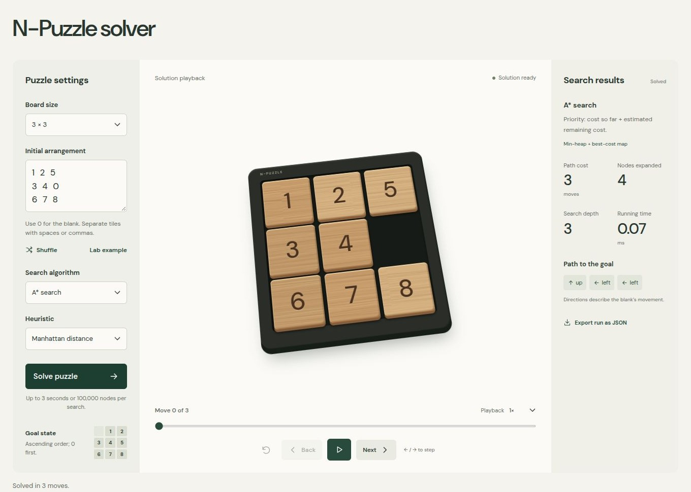
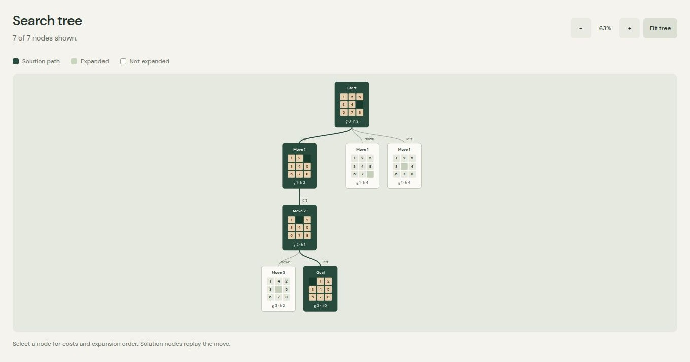
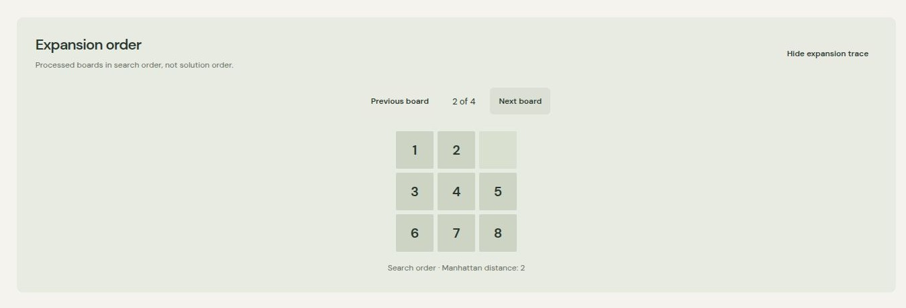

# N-Puzzle Search Visualizer

An N-puzzle solver and interactive Flask workbench for comparing breadth-first search, depth-first search, iterative deepening, and A*. Follow solutions on an animated wooden puzzle board, inspect the search tree, and step through expansion order.

The web interface supports **2×2 through 5×5 boards**, with **3×3 selected by default**. The goal arrangement is ascending order with the blank (`0`) in the **top-left corner**:

```text
0 1 2
3 4 5
6 7 8
```

## Screenshots

### Puzzle workbench



### Search tree



### Expansion order



## Features

- Four search algorithms, with Manhattan and Euclidean heuristics for A*.
- Editable starting boards and solvable shuffles generated through legal moves.
- Animated solution playback with Next, Back, Play, a move slider, and arrow-key navigation.
- Manual tile movement, including from a displayed solution step. A manual move starts a new arrangement and clears the previous result.
- Side-by-side results for BFS, DFS, iterative deepening, and both A* heuristics.
- A search-tree preview with solution highlighting, node details, zoom, and fit controls.
- Every recorded expansion from a completed search, browsable one board at a time.
- JSON export of solved runs, including paths, board states, metrics, and available comparison results.

## Getting started

You need Python 3.10 or newer. The web interface uses Flask; the console solver uses only the Python standard library.

From the repository root, create and activate a virtual environment:

```bash
python3 -m venv .venv
source .venv/bin/activate
```

On Windows PowerShell, use:

```powershell
py -m venv .venv
.venv\Scripts\Activate.ps1
```

Install dependencies and start the app:

```bash
python -m pip install -r requirements.txt
python app.py
```

Open [http://127.0.0.1:5000](http://127.0.0.1:5000). Stop the server with `Ctrl+C`. Restart it after changing Python code or templates; automatic reloading is disabled.

The included Flask server is intended for local development.

## Using the workbench

1. Choose a board size and enter each number from `0` to `N² − 1` exactly once, separated by spaces or commas. Alternatively, select **Shuffle** or **Lab example**.
2. Select an algorithm. Choose a heuristic for A*.
3. Select **Solve puzzle**. Use the playback controls to follow the returned solution. Directions describe the blank's movement.
4. Use **Compare algorithms** to run all five configurations on the same starting board. **View path** opens a comparison result on the main board.
5. Inspect the **Search tree**, open **Expansion order**, or export the solved run as JSON.

Solution playback follows legal moves along the returned path. Expansion order follows the search's processing order, so consecutive expansion boards may belong to different branches.

## Algorithms and metrics

| Algorithm | Search strategy | Options |
| --- | --- | --- |
| BFS | FIFO queue; searches level by level | — |
| DFS | LIFO stack; follows a branch before backtracking | — |
| Iterative deepening | Repeats depth-limited DFS with increasing limits | — |
| A* | Min-heap ordered by `f = g + h` | Manhattan or Euclidean distance |

Each slide costs one. Both heuristics exclude the blank. DFS returns the first solution it encounters, which can be longer than the shortest path.

The results report:

- **Path cost:** number of moves in the returned solution.
- **Nodes expanded:** processed, non-stale entries, including the goal. Iterative deepening counts all passes.
- **Search depth:** maximum processed depth, which can exceed the returned solution's length.
- **Running time:** search time, excluding HTTP overhead and JSON formatting.

### Limits and implementation notes

- Web searches stop after **5 seconds** or **1,000,000 processed nodes**. These settings live in `npuzzle/search/limits.py`. A stopped search is reported separately from an unsolvable arrangement.
- Completed searches return their full recorded expansion trace; there is no 1,500-board display or export cap. Expansion traces are currently returned only for solved runs.
- The search tree is a separate preview capped at **300 entries**. It includes generated entries and their discovery parents, omits rejected duplicate routes, and identifies truncation. A solution outside the preview may not be highlighted.
- For iterative deepening, the tree shows the final attempted pass; expansion traces and metrics include all passes.
- DFS currently skips previously explored children even when a shallower route is found later. With a depth cutoff, this can miss a solution within the chosen limit; iterative deepening uses the same DFS implementation.
- State identity uses Zobrist hashes and assumes no hash collisions. Large boards may exhaust the search budget even when solvable.

## Console and Python usage

Run the included console example:

```bash
python3 main.py
```

Use the solver from Python:

```python
from npuzzle import solveNPuzzle

start = (1, 2, 5, 3, 4, 0, 6, 7, 8)
result = solveNPuzzle(start, "a*")

if result is not None:
    print("Moves:", result.getPath())
    print("Cost:", result.getCost())
    print("Time (seconds):", result.getTime())
```

The dispatcher accepts `"bfs"`, `"dfs"`, `"ids"`, and `"a*"`. To set a depth limit directly:

```python
from npuzzle import dfs, ids

result = dfs(start, depth_limit=20)
result = ids(start, max_depth=20)
```

Direct iterative deepening (`ids`) iterates over depths 0, 1, 2, ... until a solution is found (or up to `max_depth` if specified). Direct DFS explores branches deeply without a per-pass cutoff unless `depth_limit` is specified. Direct calls have no time/node budget unless a `SearchBudget` is supplied. The compatibility import `from algorithms import solveNPuzzle` is also supported.

## Project structure

```text
app.py                  Flask page and /api/solve endpoint
main.py                 Console example
algorithms.py           Compatibility imports
npuzzle/
├── solver.py           Algorithm dispatcher
├── puzzle.py           Board configuration, legal moves, parity, and hashing
├── heuristics.py       Manhattan and Euclidean distance
├── output.py           Results and path reconstruction
├── display.py          Console board formatting
├── web_service.py      Request validation and result serialization
└── search/
    ├── bfs.py          Breadth-first search
    ├── dfs.py          Depth-first search
    ├── ids.py          Iterative deepening
    ├── astar.py        A* search
    └── limits.py       Search budgets and tree recording
templates/index.html    Workbench markup
static/
├── app.js              Tile movement, playback, comparison, and export
├── tree.js             Search-tree rendering and navigation
├── style.css           Responsive layout and puzzle styling
└── fonts/              Self-hosted DM Sans and its license
tests/test_workbench.py Solver and API regression tests
requirements.txt        Python dependencies
```

## Checks

With the virtual environment activated:

```bash
python -m unittest discover -s tests -v
```

If Node.js is installed, check JavaScript syntax:

```bash
node --check static/app.js
node --check static/tree.js
```

## Assets

The frontend uses no remote scripts or font services. Wood grain is generated in the browser. DM Sans is bundled under the [SIL Open Font License](static/fonts/OFL.txt).
