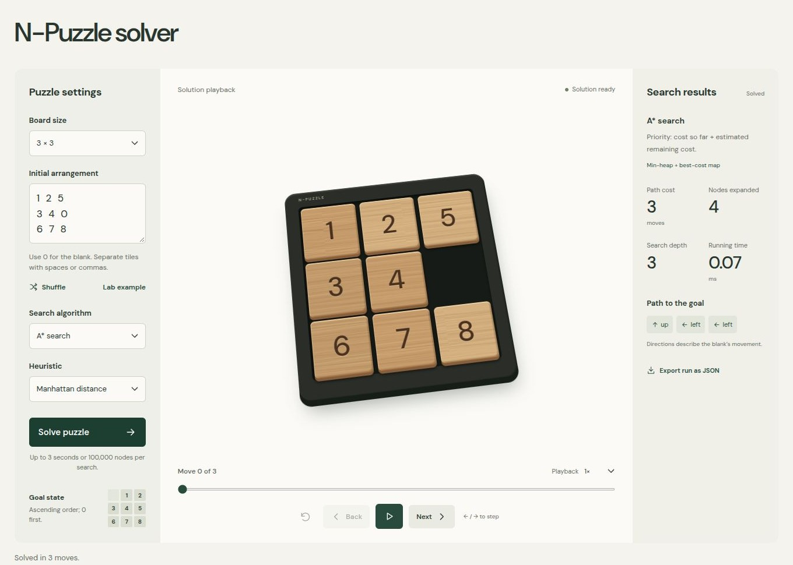
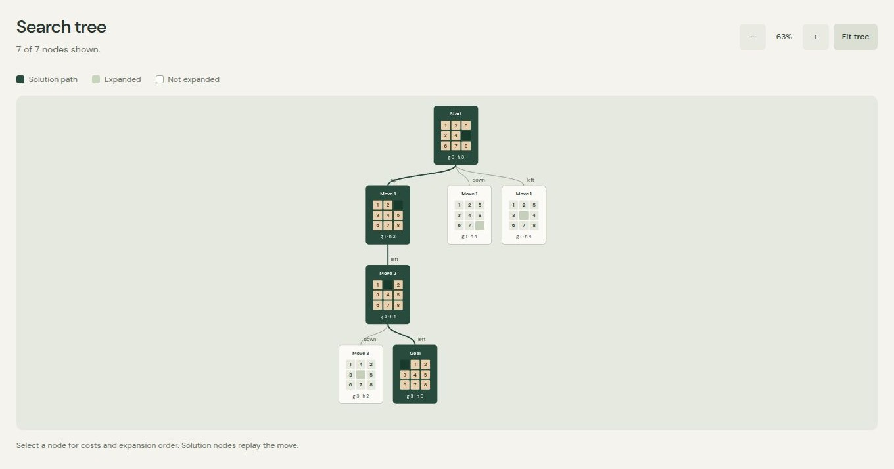
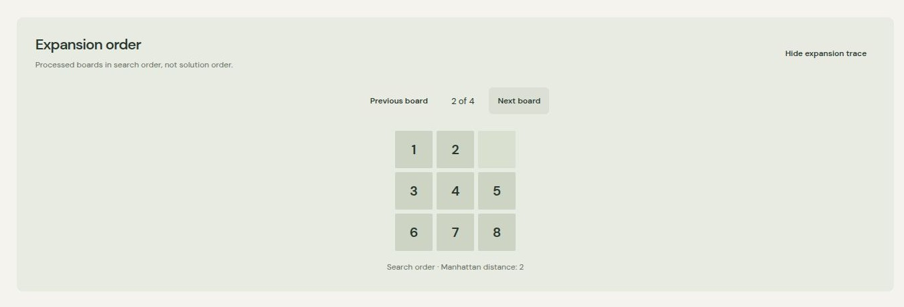

# N-Puzzle solver report

Project: N-Puzzle Solver  
Implementation: Python, Flask, and JavaScript

## 1. What We implemented

We implemented BFS, DFS, iterative deepening (IDS), and A* for the N-puzzle. The solver returns a path to the goal and records its cost, nodes expanded, maximum search depth, and running time. We also added a web interface to play back solutions and inspect the search.

The sample measurements and full move sequences are saved in [report-results.json](report-results.json).

## 2. Representing the puzzle

An N×N board contains each number from 0 to N² − 1 once. Zero is the blank. A legal move swaps it with a tile directly above, below, left, or right. Every move costs one; diagonal moves are not allowed.

We store the board as a tuple, reading across each row:

```text
Board:             State:
1 2 5              (1, 2, 5, 3, 4, 0, 6, 7, 8)
3 4 0
6 7 8
```

For a 3×3 puzzle, the goal is:

```text
0 1 2
3 4 5
6 7 8
```

The blank starts at the top left in the goal, so tile t belongs at index t. All directions describe the blank's movement: "up" moves the blank up and the numbered tile down.

We use `divmod(i, N)` to find the row and column of index i. The move generator checks boundaries, then returns valid moves in the order up, down, left, right.

## 3. Shared code and data structures

The algorithms are in `npuzzle/search/bfs.py`, `dfs.py`, `ids.py`, and `astar.py`. They share `npuzzle/puzzle.py` for board operations, `npuzzle/heuristics.py` for distance estimates, and `npuzzle/output.py` for results and path reconstruction.

| Component | Data structure | Purpose |
| --- | --- | --- |
| Board | Tuple; mutable list for swaps | Represent an arrangement and generate successors |
| State identifier | 64-bit Zobrist hash | Identify states efficiently and update identifiers after swaps |
| Parent information | Dictionary: child hash → (parent hash, move) | Reconstruct a solution after finding the goal |
| Expansion trace | List of board tuples | Preserve processing order for inspection |
| Depth trace | List of integers | Compute the greatest depth processed |
| BFS frontier | `collections.deque` | Remove the oldest entry in constant time |
| BFS visited states | Set of hashes | Avoid adding a discovered state again |
| DFS frontier | Python list used as a stack | Process the most recently pushed entry |
| DFS explored states | Dictionary: hash → depth | Record the depth at which a state was processed |
| A* frontier | List managed by `heapq` | Remove the entry with the smallest priority |
| A* best costs | Dictionary: hash → g-score | Accept improvements and skip obsolete heap entries |

### Hashing and parent links

We use Zobrist hashing to identify boards. A deterministically generated table assigns a random 64-bit value to each position-tile pair. XORing those values gives the board's hash. After a swap, We XOR out the two old assignments and XOR in the two new ones, avoiding a scan of the full board.

This assumes different boards have different hashes.

The parent dictionary stores the previous state and move for each accepted successor. Once the goal is found, We follow these links backward and reverse the moves. Replaying them gives the boards along the solution.

### What the measurements mean

Path cost is the number of moves returned. Search depth is the deepest entry processed, which can be greater than the solution length.

"Nodes expanded" counts processed entries after stale-entry checks, including the goal and entries at the depth cutoff. This is broader than counting only nodes whose children are generated. IDS counts every pass.

We measure elapsed time with `time.perf_counter()`. For successful runs, this includes the search and trace/tree recording, but excludes result serialization, HTTP transfer, and browser rendering. IDS also includes repeated DFS calls and trace aggregation.

## 4. BFS

BFS uses a FIFO queue, so it finishes one depth level before moving to the next. Each entry stores `(state, hash, blank_position, cost, depth, tree_node_id)`. We use a `deque` to remove the oldest entry first and mark states visited when enqueuing them, preventing duplicate entries from different parents.

```text
enqueue the initial state with cost 0 and depth 0
mark the initial state visited
while the queue is not empty:
    remove the oldest entry
    record its board and depth
    if it is the goal: reconstruct and return its path
    for every legal move:
        compute the successor and its hash
        if the successor has not been visited:
            mark it visited and record its parent
            enqueue it with cost + 1 and depth + 1
return no solution
```

Since every move costs one, the first goal BFS finds has the shortest path. This depends on the hash assumption and having enough resources to finish. Its main cost is memory for the queue and visited set.

## 5. DFS

DFS uses a LIFO stack to follow a branch and backtrack. We keep one mutable board and use "do" entries to apply swaps and "undo" entries to reverse them. This avoids copying the working board at each stack level, though the expansion trace still saves board snapshots.

```text
push an initial do entry
while the stack is not empty:
    pop an entry
    if it is an undo entry:
        reverse its stored swap
        continue
    if this state was already processed at an equal or shallower depth:
        skip the entry
    push an undo entry, then apply the do entry’s swap
    record the parent, board, and depth
    if it is the goal: reconstruct and return its path
    if the depth limit is reached: do not generate children
    otherwise push legal children not already in the explored map
return no solution
```

Pushing up, down, left, right means the stack normally tries right, left, down, up, skipping invalid moves. This order affects which goal it reaches first.

DFS can return a long path because it stops at the first solution. Raising its depth limit lets it follow a branch farther before backtracking. The limit counts moves from the start, so it can exceed the number of tiles.

Under a depth limit, the duplicate check tracks the depth at which states are explored. Child generation permits revisiting a state if reached via a shallower route (`seen_at > depth + 1`), and pop-time checks discard paths that are equal or deeper than previously explored paths. This allows DFS and iterative deepening to explore shorter routes without missing solutions within the depth limit.

## 6. Iterative deepening

IDS repeats DFS at limits 0, 1, 2, and so on, starting with a fresh stack and explored map each time. It stops at a solution, the optional maximum depth, or the web search budget.

```text
limit = 0
while there is no maximum depth, or limit <= maximum depth:
    run DFS from the initial state with this limit
    if a solution is returned:
        combine the expansion/depth traces of every pass
        return the solution and total elapsed time
    limit += 1
return no solution within the maximum depth
```

IDS repeats work near the root without keeping a BFS frontier between passes. It first solved the two sample boards at limits 3 and 4. Standard IDS finds a shallowest solution when its depth-limited search is complete; our implementation inherits the DFS duplicate-check issue, so that guarantee does not hold for every board. Storing traces across passes also increases memory beyond the usual textbook frontier requirement.

## 7. A*

A* removes the state with the smallest estimated total cost:

```text
f(state) = g(state) + h(state)
```

Here g is the cost so far and h estimates the remaining moves. The min-heap stores `(f, state, hash, blank_position, cost, depth, tree_node_id)`. Python compares f first, then the board tuple and later fields to break ties.

```text
best_cost[initial] = 0
push the initial state with priority h(initial)
while the heap is not empty:
    pop the entry with the smallest priority
    if its cost exceeds the best recorded cost: skip it
    record its board and depth
    if it is the goal: reconstruct and return its path
    for every legal successor:
        new_cost = current_cost + 1
        if new_cost improves the successor’s recorded cost:
            update its best cost and parent
            push it with priority new_cost + h(successor)
return no solution
```

The best-cost dictionary only accepts cheaper routes. A new route gets a new heap entry; older entries stay until popped, when the stale-entry check skips them. This avoids a decrease-key operation.

### Heuristics

Manhattan distance adds the row and column distances of each numbered tile from its goal:

```text
h_Manhattan = sum(|row − goal_row| + |column − goal_column|)
```

Euclidean distance adds the straight-line distances:

```text
h_Euclidean = sum(sqrt((row − goal_row)² + (column − goal_column)²))
```

Both ignore the blank and are admissible and consistent: each legal move shifts one numbered tile by one grid step. A* therefore finds a shortest path if the hash assumption holds and the budget allows it to finish. Manhattan is at least as large as Euclidean on every board and is usually more informative, though ties and calculation overhead affect actual node counts and time.

## 8. Sample runs

Every run had a budget of 5 seconds or 1,000,000 processed nodes. We explicitly set DFS and IDS to a maximum depth of 32, except for the cutoff example. These are single-run measurements, not averaged benchmarks. Hardware, scheduling, caches, Python version, and recording overhead affect timing; sub-millisecond differences do not establish a reliable speed ranking.

### Sample A: lab example

```text
Initial:            Goal:
1 2 5               0 1 2
3 4 0               3 4 5
6 7 8               6 7 8
```

| Algorithm | Status | Path cost | Nodes expanded | Search depth | Time (ms) |
| --- | --- | ---: | ---: | ---: | ---: |
| BFS | solved | 3 | 11 | 3 | 0.0894 |
| DFS (limit 32) | solved | 31 | 11,765 | 32 | 30.0911 |
| Iterative deepening | solved | 3 | 32 | 3 | 0.1106 |
| A* — Manhattan | solved | 3 | 4 | 3 | 0.0451 |
| A* — Euclidean | solved | 3 | 4 | 3 | 0.0469 |

BFS, IDS, and both A* variants found this path:

up → left → left

```text
Start          up             left           left / goal
1 2 5          1 2 0          1 0 2          0 1 2
3 4 0          3 4 5          3 4 5          3 4 5
6 7 8          6 7 8          6 7 8          6 7 8
```

Both heuristics decrease from 3 to 2 to 1 to 0 along the path. A* processes those four boards. IDS fails at limits 0, 1, and 2 before succeeding at 3; its count of 32 includes all four passes.

DFS returned this 31-move path:

```text
left → left → down → right → right → up → left → down → right → up → left → left → down → right → right → up → left → down → left → up → right → right → up → left → left → down → right → down → left → up → up
```

It explored other branches to depth 32 before finding the goal at depth 31, which explains why search depth exceeds path cost.

### Sample B: four-move arrangement

```text
Initial:
1 4 2
3 7 5
6 8 0
```

| Algorithm | Status | Path cost | Nodes expanded | Search depth | Time (ms) |
| --- | --- | ---: | ---: | ---: | ---: |
| BFS | solved | 4 | 24 | 4 | 0.0773 |
| DFS (limit 32) | solved | 16 | 34,299 | 32 | 84.2373 |
| Iterative deepening | solved | 4 | 42 | 4 | 0.1338 |
| A* — Manhattan | solved | 4 | 5 | 4 | 0.0544 |
| A* — Euclidean | solved | 4 | 5 | 4 | 0.0401 |

BFS, IDS, and both A* variants returned:

left → up → up → left

```text
Start          left           up             up             left / goal
1 4 2          1 4 2          1 4 2          1 0 2          0 1 2
3 7 5          3 7 5          3 0 5          3 4 5          3 4 5
6 8 0          6 0 8          6 7 8          6 7 8          6 7 8
```

DFS returned this 16-move path:

```text
left → left → up → right → up → right → down → left → left → down → right → up → right → up → left → left
```

A* processes just the five solution boards. Both heuristics have identical expansion counts in these two samples; a wider set of boards would be needed to compare them.

## 9. Assumptions and limits

The unit move cost and top-left blank goal apply throughout. Changing to a bottom-right blank goal would require changing the goal checks and heuristics.

The web service accepts square boards from 2×2 to 5×5 with each required integer present once. It rejects invalid input and checks solvability before searching. For odd widths, the inversion count must be even. For even widths, the parity of inversions plus the blank's row from the bottom must match the goal.

Web searches stop at 5 seconds or 1,000,000 processed nodes. Resource stops, depth cutoffs, and unsolvable inputs have separate statuses.

Solved runs return the full expansion list. Unsuccessful and limited runs currently return metrics and a partial tree, but no full expansion list.

The tree preview holds at most 300 accepted entries with their discovery parents. Rejected duplicate routes are omitted, so it is only a preview of the search. A solution is highlighted only when its complete branch is recorded. IDS shows the final pass's tree while its metrics cover all passes.

Expansion snapshots and parent/explored maps can use substantial memory.

## 10. Extra work

We separated the solver into reusable puzzle, heuristic, output, and display modules and kept a console demo. The Flask JSON API validates requests and returns moves, solution boards, metrics, heuristic values, and tree data.

The responsive frontend has a dark board with procedural wooden tiles, animated slides, and manual legal moves. Next, Back, and Play controls, a slider, speed selection, and keyboard stepping let the user follow a solution. A comparison table runs BFS, DFS, IDS, and A* with both heuristics on the same board.

The tree viewer shows discovery branches; the expansion viewer follows processing order. JSON export saves solved runs and available comparison results. Regression checks cover paths, validation, board sizes, budgets, and tree edges.







